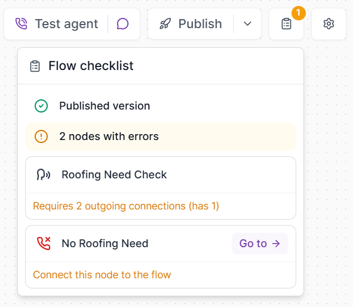

The **Flow Checklist** reports reachable block errors, interim-message playback warnings, publish-review findings, and whether the flow has a published version. Select the clipboard icon beside **Publish** to open it. A badge appears when a check needs attention.

## What the checklist checks

| Check | What it means |
| :-- | :-- |
| **Published version** | Whether the flow has been published at least once. Without one, Phonely falls back to the current draft. This is a warning, not a publishing blocker. |
| **Block errors** | Whether a trigger or action block reachable from the flow's entry point has missing connections, invalid variables, invalid JSON bodies, or incomplete required settings. These errors prevent publishing. |
| **Interim messages** | Warns when an enabled interim message on a reachable block will not play because it follows another action in the sequence. This is advisory and does not block publishing; move needed caller feedback to the sequence's first action. |
| **Publish review** | Advisory findings from the AI review that runs when you publish. On a flow that already has a published version, it reports only serious problems your draft introduces, including a **Talk** exit that cannot be taken. The review waits up to eight seconds. Review or fix relevant findings, or choose **Publish anyway** when the draft is ready. |

When every check passes, the panel shows **All issues are resolved**.

## Fix block errors

1. Open the **Flow Checklist**.
2. Review the messages shown under each affected block.
3. Hover over a block entry and select **Go to**. Phonely centers the block on the canvas and opens its configuration panel.
4. Correct each connection, variable, or setting named in the messages.
5. Reopen the checklist and confirm that the block no longer appears.

JSON syntax errors do not stop draft autosaving, but a reachable block with those errors must be fixed before publishing.

## What passing the checklist means

The checklist evaluates the current draft and updates as you edit it. Publishing remains blocked while a reachable block has errors. An unconnected block parked on the canvas is not part of the executable flow and does not block publishing until it becomes reachable.

Resolving the blocking checks confirms that required configuration is present; it does not prove that every conversation path behaves as intended. Test important routes, fallbacks, transfers, and post-call actions before relying on the flow for live calls.

See [Test and Publish](/flow-editor/test-and-publish) for the complete edit, validate, publish, and test process.
